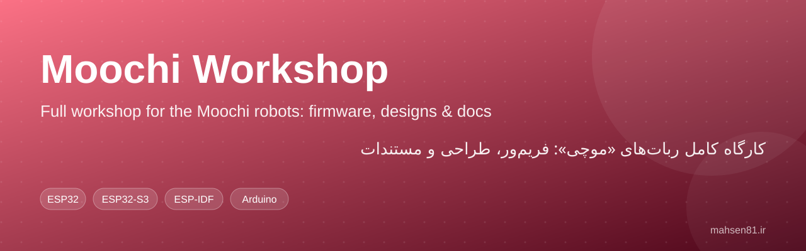
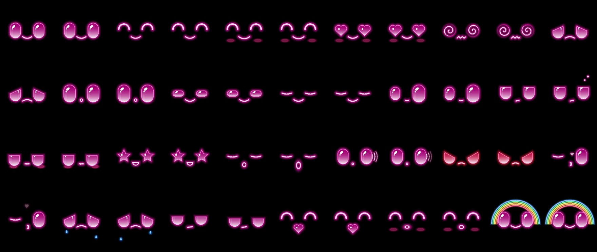

<!-- gen:header -->
<p align="center"></p>

<h1 align="center">Moochi Workshop</h1>
<p align="center"><b>کارگاه کامل ربات‌های «موچی»: فریم‌ور، طراحی و مستندات</b><br><i>Full workshop for the Moochi robots: firmware, designs & docs</i></p>
<p align="center">   </p>

<div dir="rtl">

## ✨ امکانات

- دو ربات: ربات پت تانکی و موچی کوچولو
- فریم‌ور برای چند برد، از جمله Waveshare 1.85
- نمونه‌های چت صوتی با هوش مصنوعی
- مستندات فارسی پروژه

</div>

## 📸 تصاویر · Screenshots

<p align="center">  </p>

## 🚀 Quick start

```bash
See firmware/ and moochi2/ — each has its own build steps.
```

---

<p align="center">ساخته‌شده توسط <a href="https://mahsen81.ir"><b>محسن جباره‌اصل</b></a> — برنامه‌نویسی، طراحی سایت، ربات و هوش مصنوعی<br>
Built by <a href="https://mahsen81.ir">Mohsen Jabbareh-Asl</a> · ⭐ اگر مفید بود، ستاره بدهید · Need a custom version? <a href="https://mahsen81.ir">Get in touch</a></p>
